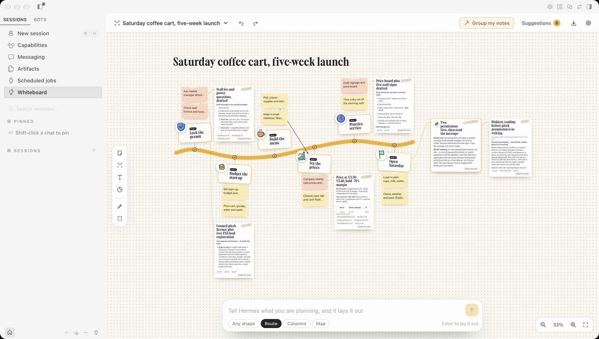
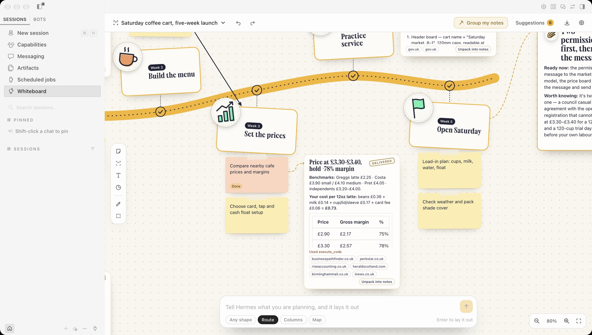

# Hermes Whiteboard

An agentic whiteboard for Hermes Desktop. You think a plan through on a board. Hermes lays it out, finds the groups in your notes, and sends agents to do the work, right there on the board.

Part of [Hermes Folio](https://adolanium.github.io/hermes-folio/), with [Sheets](https://github.com/Adolanium/hermes-sheets) and [Data](https://github.com/Adolanium/hermes-data). Each works alone.



## What it does

**One sentence becomes a board.** Tell Hermes what you are planning. It lays the plan out as a route (steps in order along a road), columns (groups side by side) or a map (ideas around one centre), with hand-drawn stamps, notes and action items. A gold Hermes cursor places each piece and the camera follows it.

**Run the route.** One click and Hermes travels the board stop by stop. At each stop its agents fan out over that stop's action items, each under its own cursor, up to three at a time. The road behind turns gold. What one stop delivered is handed to the next, so later work builds on earlier work. At the end Hermes writes one brief of everything that is ready.



**Hand any note to Hermes.** Every note has a Hand to Hermes button. An agent does the item and delivers a finished result next to the note: the draft itself, the comparison itself, the answer with its sources.

**Group my notes.** Throw rough notes on the board. Hermes suggests groups, owners and action items, each with a reason. You accept or skip each one, and every accepted change can be taken back.

**Ask about anything you select.** Select notes, a group or a result, or drag a box around part of the board, and ask a question. The answer lands as a card beside what you asked about.

**Unpack a result.** Any delivered result can be unpacked into notes and next steps, which arrive as suggestions like everything else.

**A real whiteboard underneath.** Notes in six colours, groups, text, 32 stickers, arrows you draw between items, a pen, resize, duplicate, copy and paste, undo and redo, pan and zoom. Text grows as you zoom out, so a board fitted to the window still reads.

**With Sheets and Data.** When the [Sheets](https://github.com/Adolanium/hermes-sheets) or [Data](https://github.com/Adolanium/hermes-data) plugin is on, their **Pin to board** button puts ticked rows, or what each chart of a report says, on your open board as one new group of notes. One undo takes the group off again.

**From any chat.** Once you allow it, any Hermes chat can read your boards, start a new one, and propose notes, groups and action items that wait on the board for you.

**Take it with you.** Export a board as Markdown, as CSV, or copy it as a table to paste into Hermes Sheets or any spreadsheet.

## Install

```sh
hermes plugins install Adolanium/hermes-whiteboard
```

A desktop plugin installed from the command line starts switched off. Open **Capabilities › Plugins**, find **Whiteboard**, and switch it on. Then choose **Whiteboard** in the sidebar.

## Keys

| Key | Does |
|---|---|
| Double-click the board, or N | New note |
| Enter | Edit the selected item |
| P | Pen |
| L | Select an area |
| Shift-drag | Select an area |
| Cmd D, Cmd C, Cmd V | Duplicate, copy, paste |
| Cmd Z, Shift Cmd Z | Undo, redo |
| Backspace | Delete |
| Scroll, pinch or Cmd-scroll | Pan, zoom |

## AI, when you ask

Nothing runs until you click.

- **Laying out a board, grouping notes, unpacking a result and the final brief** each start one hidden Hermes session. They are told to use no tools.
- **Hand to Hermes, Run the route and Ask** start hidden Hermes sessions that may use your Hermes tools, mainly web search and page reading. Each agent is told not to send messages, write files, run commands or schedule anything. If one uses such a tool anyway, its result card says which.
- **Approval prompts inside these sessions are denied automatically,** because nobody could see them.
- **Budgets.** An agent stops after 4 minutes or 24 tool calls. At most three run at once. Every run has a Stop button.
- Hermes gives plugins no way to delete sessions, so these stay hidden in your session store.
- **Which model does the work.** Settings has a **Planning model** (laying out, grouping, unpacking, the brief) and an **Agent model** (Hand to Hermes, Run the route, Ask). Both start on "Hermes default", which sends nothing extra, so your Hermes default model does everything. Pick another and Whiteboard names that model when it creates the session. The list holds the models Hermes says you are signed in to. Sign-in and keys stay in Hermes and never reach the plugin.
- **No silent fallback.** If Hermes cannot use a model you picked, that run stops and says so. It is not retried on your default. A result done by a picked model says which one at the bottom of its card.

Model calls apply normal usage costs, and each model is billed by its own provider.

## Privacy

```text
Your Hermes Desktop  →  local board storage  →  your Hermes model (only when you ask)
                     ↘  a copy in Hermes plugin data (only after you let chats read your boards)
                     ↘  the web, through your Hermes web tools (only when an agent researches)
```

- Boards live in Hermes plugin storage on this desktop.
- **Chats can read my boards** is off until you turn it on in Settings. While it is on, Whiteboard keeps a copy of each board under `plugin-data/whiteboard/` in your Hermes home so the chat tools can read it. Turning it off deletes the copies.
- **Export** writes the one Markdown or CSV file you name in the system save dialog. The page opens the dialog with the Desktop SDK and hands the path to Whiteboard's own backend, which refuses other file types and anything inside your Hermes home.
- **Sheets and Data pin notes here inside the app window**, with a browser event between the pages, and only when you click. Nothing is written to disk for it, no backend is called and no model is involved. The notes are added beside what is on the board and never change it. Any other Desktop plugin you have switched on runs in the same window and could send or read such an event.
- No telemetry, no credentials, no shell commands or background processes of its own. The page makes no network requests of its own.

## Limits

- One person per board. There is no live multiplayer.
- Stickers are a built-in set. Hermes picks among them; it does not generate images.
- Chats see boards only while Hermes Desktop is running with Whiteboard switched on.
- A board holds up to 600 items.

## Development checks

```sh
node check.mjs
node --test tests/board.test.mjs
python -m pytest tests/test_tools.py
hermes plugins validate .
```

The page is one hand-written, unminified file with no bundled third-party code. It uses only the Desktop SDK: no raw desktop bridge, no `eval`, no dynamic loading.

## License

MIT. Independent community project, not affiliated with Nous Research.
